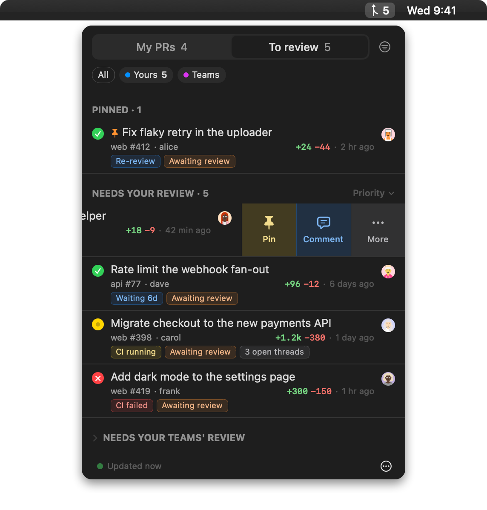

<p align="center">
  
</p>

<h1 align="center">Pullglance</h1>

<p align="center">Your pull requests and review requests at a glance, in the macOS menu bar.</p>

<p align="center">
  <a href="https://github.com/andersonba/pullglance/actions/workflows/ci.yml"></a>
  <a href="LICENSE"></a>
</p>

<p align="center">
  
</p>

I kept opening GitHub to find the one pull request that actually needed me. This is that list, in the menu bar.

Pullglance talks to GitHub through the `gh` CLI you are already logged into. No GitHub App, no OAuth, no server, no tokens of its own.

- **See what depends on you.** Failing checks, approvals ready to merge, reviews asked of you, with a number on the menu bar.
- **Act from the row.** Merge, comment, snooze, pin, from the mouse or the keyboard.

## Install

Requires macOS 15 on Apple silicon and [Homebrew](https://brew.sh). The cask brings the [GitHub CLI](https://cli.github.com) with it.

```sh
brew tap andersonba/pullglance https://github.com/andersonba/pullglance
brew install --cask andersonba/pullglance/pullglance
```

Pullglance uses the `gh` login on your Mac. This logs you in only if you are not already:

```sh
gh auth status || gh auth login
```

The app is not notarized, so macOS blocks the first launch: open it once, then allow it in System Settings › Privacy & Security › Open Anyway. That happens once. From then on the app updates itself: each release shows up in its menus, and installing it is one click, with no terminal and no new prompt. `brew upgrade --cask pullglance` still works if you prefer it, and brings the Open Anyway step back for that one launch.

To build it yourself, with Xcode 26 (remove a Homebrew copy first; both live in /Applications):

```sh
git clone https://github.com/andersonba/pullglance && cd pullglance
Scripts/make-app.sh --install
```

## Privacy

Everything stays on your Mac. Preferences in `UserDefaults`, author avatars in `~/Library/Caches`, a small rolling log in `~/Library/Logs/Pullglance` with no titles, bodies or tokens in it. Nothing is sent anywhere but GitHub, through `gh`.

## Developing

```sh
swift run                     # a debug build, for iterating: no Dock icon, its own settings, gone with the terminal
Scripts/make-app.sh --install # the release app from this checkout, installed in /Applications: how to run it from source day to day
swift test                    # run the tests
Scripts/build-review-js.sh    # rebuild the Review Desk's page script
Scripts/release.sh X.Y.Z      # cut a release from main: tests, tag, zip, cask, GitHub Release
```

Builds need Xcode 26 or newer. [CLAUDE.md](CLAUDE.md) has the notes a coding agent (or a new contributor) needs: the two ways to run it, where the log is, the build checks, and the toolchain pitfalls.

How it works, section by section: [docs/how-it-works.md](docs/how-it-works.md).

## Contributing

Issues and pull requests are welcome. Small, focused changes land faster.

## License

MIT. See [LICENSE](LICENSE).

<p align="center"><em>Vibe coded.</em></p>
